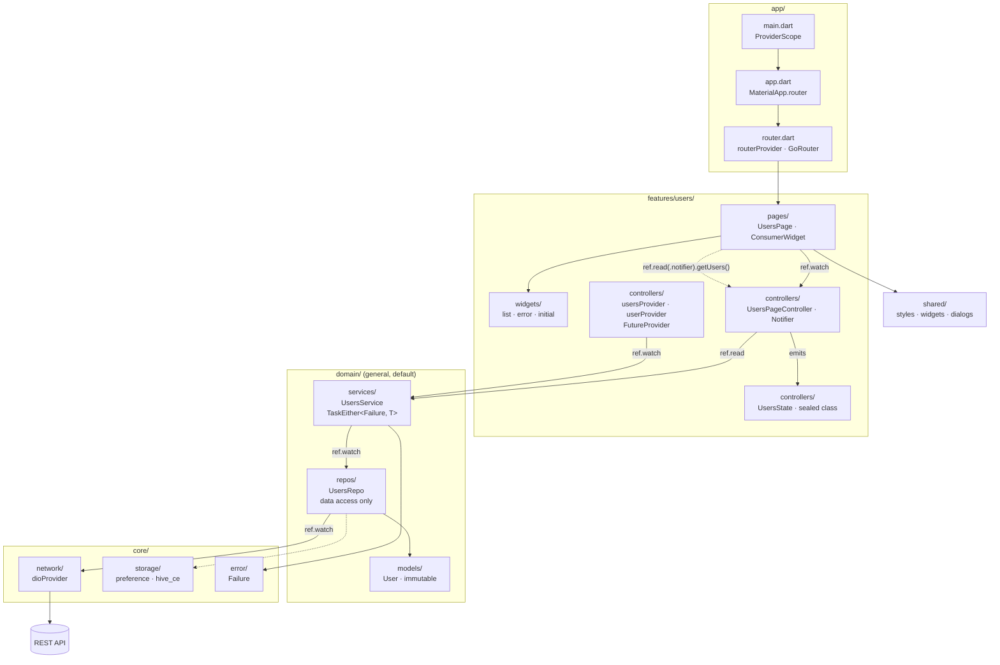

# flutter_mvvm_clean_architecture

<h1 align="center" style="font-size: 52px;" > Flutter MVVM clean architecture Template </h1>

A time saving template to demonstrate MVVM Clean Architecture with basic project structure using Restful apis, Graphql and Riverpod to get started rather than creating all the folders/files with every new project.

Built for **Flutter 3.47 / Dart 3.13**, with **no code generation**: state classes are plain Dart 3 `sealed` classes, models implement `==`/`hashCode` by hand, and providers use the manual Riverpod 3 syntax, so there's no `build_runner` step.

### 📚 Cheat sheets
- [Riverpod 3 Field Guide](https://claude.ai/artifact/PqNdX9ZtNpx8t2bJBBQjAZ): interactive provider graph, `ref` API, Notifier/AsyncNotifier, testing.
- [go_router Field Guide](https://claude.ai/artifact/EhdNAa6Y7YBsAhxxEXu8rx): route simulator, redirects, shell routes, deep links.

### 🧗🏼‍♂️ Milestones
- [x] MVVM Design Pattern using [Riverpod 3](https://riverpod.dev/) `Notifier` + sealed state classes (no freezed).
- [ ] Multiple App flavors (LOCAL-STAGING-PRODUCTION) for testing [links](https://petalite-browser-25b.notion.site/Multiple-App-Flavors-42cb9610784844ff880385afa6dde4e9).
- [x] Common components like buttons, text inputs, etc
- [x] Routing and navigation layer using [go_router](https://pub.dev/packages/go_router).
- [x] Functional error handling with [fpdart](https://pub.dev/packages/fpdart) `TaskEither`/`Either`.
- [ ] Data persistence layer through [Hive CE](https://pub.dev/packages/hive_ce) [notes](https://petalite-browser-25b.notion.site/Local-Data-Persistence-ea7ee06d9ca141bd80d54e142a0f5875).
- [ ] Widget shortcuts and shimmer effects [links](https://petalite-browser-25b.notion.site/Extensions-ab305b18c8a64d91942566de0353f5c5).
- [ ] CI/CD via Github actions or codemagic.
- [ ] [Notifications](https://petalite-browser-25b.notion.site/Notifications-1df2c4ce93c54d23a96490ce926fc2b6).
- [ ] Responsive Framework.
- [x] Out of the box extensions.
- [x] SharedPreferences.
- [ ] Localizations.
- [x] Native Splash Screen [flutter_native_splash](https://pub.dev/packages/flutter_native_splash).
- [ ] Crash Reports [firebase_crashlytics](https://pub.dev/packages/firebase_crashlytics) OR [sentry_flutter](https://pub.dev/packages/sentry_flutter).
- [ ] Toasts which are globally accessible.
- [ ] Connectivity check. //#internet_connection_checker
- [ ] Restful api client
- [ ] Graphql client
- [ ] [requests interceptors](https://medium.com/flutter-community/dio-interceptors-in-flutter-17be4214f363).
- [ ] [In-App update](https://petalite-browser-25b.notion.site/In-App-update-b05cfd08611046d7a0f6c7f4a97c32e8)
- [x] Structured test directory mirroring `lib/`.
- [x] Unit testing for page controllers (`ProviderContainer.test` + overrides).
- [ ] Widget testing for UI layer.

### 🏛 Architecture


**Call flow:** `page → controller → service → repo → dio/db`. State flows back to the page as a sealed `UsersState`, matched with an exhaustive `switch`.

### 🗂 Folder structure
```
lib/
  main.dart                 init services + ProviderScope
  app/                      app.dart (MaterialApp.router), router.dart (routerProvider)
  core/
    constants/  error/  extensions/  utils/
    network/                dioProvider, graphql client
    storage/                shared preferences, hive
  domain/                   shared by every feature, the default place for logic
    models/                 plain immutable models (manual ==/hashCode, fromJson/toJson)
    repos/                  data access only: api / local db -> models
    services/               business logic, combine repos, return TaskEither<Failure, T>
  features/
    users/
      controllers/          page controllers (Notifier) + sealed states + FutureProviders
      pages/                screens
      widgets/              widgets used only by this feature
      (repos/ services/)    optional, only for logic no other feature will ever use
  shared/                   app-wide UI: styles/, widgets/, dialogs/
test/                       mirrors lib/
```

Page controllers read services directly from `domain/services`, so there's no use-case layer to write.
Repos and services are concrete classes with a `Provider`; tests fake them with `overrideWithValue` (see `test/features/users/`), so no interfaces are needed.

**Where does a file go?** Ask whether it would make sense, unchanged, in a completely different app.
- Yes → `core/`
- No, and several features use it → `domain/`
- No, and only one feature uses it → that feature's folder

Dependencies only go one way: `features → domain → core`, never back.

### 🧩 State example (no codegen)
```dart
sealed class UsersState { const UsersState(); }
final class UsersInitial extends UsersState { const UsersInitial(); }
final class UsersLoading extends UsersState { const UsersLoading(); }
final class UsersData extends UsersState { final List<User> users; const UsersData(this.users); }
final class UsersError extends UsersState { final Failure failure; const UsersError(this.failure); }

final usersPageControllerProvider =
    NotifierProvider.autoDispose<UsersPageController, UsersState>(UsersPageController.new);

// in the widget, exhaustive pattern matching:
switch (ref.watch(usersPageControllerProvider)) {
  UsersInitial() => const InitialUsersWidget(),
  UsersLoading() => const CircularProgressIndicator(),
  UsersData(:final users) => UsersListWidget(users: users),
  UsersError(:final failure) => UsersErrorWidget(failure: failure),
}
```

### 📦 Packages
- `material_ui: ^1.9.0` (Material widgets, split out of the framework in Flutter 3.47)
- `flutter_riverpod: ^3.4.3`
- `go_router: ^18.1.2`
- `fpdart: ^1.2.0`
- `hive_ce: ^2.22.0` / `hive_ce_flutter: ^2.5.0`
- `dio: ^5.11.1`
- `graphql: ^5.2.4`
- `shared_preferences: ^2.5.6`
- `google_fonts: ^9.0.0`
- `cached_network_image: ^4.0.6`
- `awesome_extensions: ^2.1.2`
- `auto_size_text: ^3.0.0`
- `date_format: ^2.0.9`
- `url_launcher: ^6.3.3`
- `mime: ^2.1.0`
- `path: ^1.9.1`
- `logger: ^2.8.0`
- `cupertino_icons: ^2.0.0`

### 🔻 Getting started
Requires Flutter 3.47+. Open CMD/Terminal and run the following commands:
```cmd
git clone https://github.com/amrahmed242/flutter-clean-architecture-template.git

cd flutter-clean-architecture-template

flutter pub get

flutter run --dart-define=FLAVOR=STAGING
```

Run the tests with `flutter test`.

### 🔑 License
- This project is licensed under the MIT License - see the [LICENSE](LICENSE) file for details

### 🧑 Author

#### Amr Ahmed
[LinkedIn Link](https://www.linkedin.com/in/amrahmed24/)
You can also follow my GitHub Profile to stay updated about my latest projects:
[GitHub Follow](https://github.com/amrahmed242)
If you liked the repo then kindly support it by giving it a star ⭐!

Copyright (c) 2021 AmrAhmed.
